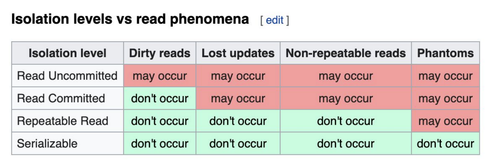

# ACID

## Principles

### Atomicity
* It guarantees that a transaction—which might contain multiple SQL steps—is treated as a single, indivisible unit of work. Either every single step succeeds and is saved (Committed), or if even one-step fails, the entire transaction is canceled and undone (Rolled Back).

### Isolation
* A **dirty read** is a database anomaly that occurs when Transaction A reads data that has been modified by Transaction B, but Transaction B has not yet committed the change 
* A **non-repeatable read** is a database concurrency anomaly that occurs when a transaction reads the same row of data twice but gets different values each time because another concurrent transaction modified and committed that row in the interim 
* A **phantom read** occurs when a transaction inserts a query returning a range of rows, but when it re-runs that exact same query later, it finds newly created "phantom" rows inserted by another transaction that committed in the meantime. 
* A non-repeatable read affects existing rows, while a Phantom read introduces entirely new rows. 
* PostgreSQL uses a versioning system called MVCC (Multi-Version Concurrency Control). The Repeatable Read isolation level in Postgres, both non-repeatable reads and phantom reads are completely blocked, meaning your queries will return the exact same rows and values even if another transaction has committed changes in the meantime. 
* A **lost update** is when two transactions read the same data at the same time, modify it, and then write it back, causing one transaction to overwrite and completely erase the other's changes.

#### Isolation Levels:
* Each DBMS implements Isolation level differently.
* **Read uncommitted:** No Isolation, any change from the outside is visible to the transaction, committed or not. Example: Dirty Reads, but faster.
* **Read committed:** Each query in a transaction only sees committed changes by other transactions, it is default isolation level by dbs.
* **Repeatable Read:** The transaction will make sure that when a query reads a row, that row will remain unchanged while its running. Example: Never returns a different value unlike non-repeatable read but not phantom read.
* **Snapshot:** Each query in a transaction only sees changes that have been committed up to the start of the transaction. It's like a snapshot version of the database at that moment. It is very expensive to use. It completely removes phantom read completely read phenomenas and by default postgres uses this.
* **Serializable:** No concurrency transactions, only 1 transaction run at a time.



#### Implementation of Isolation:
* **Row level locks:** When Transaction A accesses a specific row with intent to update, it places an exclusive lock. Transaction B attempting to modify or read-for-update that same row is forced to wait until Transaction A commits or rolls back.
* **Page level locks:** A Table is a Logical Concept; It represents your schema, columns, and relations (e.g., customers). A Page is a Physical Container; It is a fixed-size chunk of disk/memory (e.g., 8 KB or 16 KB). Rows are Stored Inside Pages; Rows are placed side-by-side inside pages until the page runs out of space. A single table usually spans hundreds, thousands, or millions of pages. In modern relational engines, a data page belongs to only one table. If Transaction A updates Row 1 and Transaction B wants to update Row 50, but both happen to reside on the same physical page, Transaction B must wait even though the two transactions operate on completely unrelated business entities.
* **Table level locks:** Transaction A acquires an exclusive table-level lock. No other transaction can read or write to any record in that table until Transaction A finishes.

### Consistency

#### Consistency in Data
* A common example of consistency failure in real systems is inconsistent or corrupted data. Without foreign key constraints, child tables can end up with orphan records—such as an order referencing a non-existent customer ID.
* Atomicity ensures multi-step modifications do not stop halfway (like debiting one account without crediting the other).
* Isolation prevents concurrent transactions from seeing each other's half-finished results.
* Consistency represents the final guarantee: once a transaction finishes, the database as a whole remains complete with every relational rule defined in the schema.

#### Eventual Consistency in Distributed / NoSQL Databases
* In distributed databases like Amazon DynamoDB, Apache Cassandra, or MongoDB, data is replicated across multiple physical servers (nodes) to guarantee high availability and fault tolerance.
* When an item is written or updated, the database engine returns a success response as soon as a acknowledges the write, and then asynchronously replicates that change to the remaining replica nodes in the background.
* **Eventual consistency** refers to an application updates a record and immediately attempts to read it, the request might be routed to a replica node that has not yet processed the background sync, returning old data.
* There are different kind of replication such as Synchronous replication & Asynchronous replication.
* It is important to distinguish this from ACID consistency. While ACID consistency focuses on schema validity and integrity rules (such as foreign key constraints and check conditions), eventual consistency is purely a distributed systems concept governing how quickly data synchronization achieves uniform state across multiple machines.

### Durability
* It guarantees that once a transaction commits, its modifications are permanently recorded in non-volatile storage and will survive power outages, OS crashes, or hardware reboots.
* **Write-Ahead Logging (WAL):** In relational databases (such as PostgreSQL and MySQL), Write-Ahead Logging guarantees that a sequential, append-only log entry describing every insert, update, and commit record is physically added to disk via an `fsync` operation, without `fsync` it may write log to `cache`.
  * **LSN (Log Sequence Number):** A monotonically increasing 64-bit integer tracking the entry's position.
  * **Transaction ID (XID):** Identifies which transaction executed the change.
  * **Record Type:** `INSERT, UPDATE, DELETE, COMMIT, ABORT, or CHECKPOINT`.
  * **Target Location:** Specific Page ID and Offset (Slot number) on disk.
  * **Undo/Redo Payloads:** Redo data has values needed to re-apply the changes. Undo data has values before the change (used to roll back if aborted).
  * If db crashes after `LSN: 10455`, the actual table data on disk may not have been updated yet. During crash recovery, the database boots up, inspects the WAL, get the transaction and find the `[COMMIT]`, and replays operations `10453` and `10454` into the table pages.
    ```
    [LSN: 10452] [XID: 801] [START]
    [LSN: 10453] [XID: 801] [INSERT] Page: 42, Slot: 3, Data: (id=10, name='Alice', balance=500)
    [LSN: 10454] [XID: 801] [UPDATE] Page: 88, Slot: 1, PrevVal: (balance=200), NewVal: (balance=100)
    [LSN: 10455] [XID: 801] [COMMIT]   <-- WAL added to disk (fsync). Client receives success!
    ```
  * WAL records are only discarded or overwritten after a process called a Checkpoint occurs.
  * In engines like **PostgreSQL**, WAL files are fixed-size segments (typically 16 MB each). Once all transactions have been checkpointed, the engine either deletes the file or renames and reuses it for upcoming log entries.
* **Asynchronous Snapshot:** In systems like Redis, the primary data structure lives directly in RAM for microsecond speeds. To achieve durability, Redis offers periodic asynchronous point-in-time snapshots called RDB (Redis Database file).

## Implementation

### Setup

```shell
docker pull postgres:latest
docker run -d --name pgacid -e POSTGRES_PASSWORD=postgres postgres:latest
docker exec -it pgacid psql -U postgres
```

```psql
create table products (pid serial primary key, name text, price float, inventory integer);
create table sales (sid serial primary key, pid integer, price float, quantity integer);
insert into products (name, price, inventory) values ('Phone', '999.99', 100);
```

### Atomicity & Consistency

Transaction A
```psql
begin transaction;
update products set inventory = inventory - 10;
insert into sales (pid, price, quantity) values (1, 999.99, 10);
select * from products;
select * from sales;
commit; # or rollback;
```

Transaction B
```psql
select * from products; # It reads 100 unless commited.
select * from sales; # It reads 0 unless commited.
```

### Isolation

Transaction A
```psql
begin transaction; # default isolation level is read committed.
select pid, count(pid) from sales group by pid;
# Transaction B committed here, which costs phantom read problem.
select pid, price, quantity from sales; 
```

Transaction B
```psql
begin transaction;
insert into sales (pid, price, quantity) values (1, 999.99, 10);
update products set inventory = inventory - 10 where pid = 1;
commit;
```

Ideal Transaction A Isolation Level should be **repeatable read** in postgres or **serializable** in other dbs, which freezes the view—ensuring the entire transaction only sees the data as it existed at the start.
```psql
begin transaction isolation level repeatable read;
begin transaction isolation level serializable;
```

#### Serializable vs Repeatable Reads

**Repeatable Read Level**

```psql
select * from test;
 id | t 
----+---
  1 | b
  2 | b
  3 | a
  4 | a
```

Transaction A
```psql
begin transaction isolation level repeatable read;
update test set t = 'a' where t = 'b';
commit;
```

Transaction B
```psql
begin transaction isolation level repeatable read;
update test set t = 'b' where t = 'a';
commit;
```

```psql
select * from test;
 id | t 
----+---
  1 | a
  2 | a
  3 | b
  4 | b
```

**Serializable Level:** Under Serializable isolation, concurrent/parallel transactions that aborts the second transaction with a serialization error to preserve serial correctness.

Transaction A
```psql
begin transaction isolation level serializable;
update test set t = 'a' where t = 'b';
commit;
```

Transaction B
```psql
begin transaction isolation level serializable;
update test set t = 'b' where t = 'a';
commit; ❌ throws error, because transaction A is committed first while transaction B is open.
```

```psql
select * from test;
 id | t 
----+---
  1 | a
  2 | a
  3 | a
  4 | a
```

## TODO: Pessimistic vs Optimistic