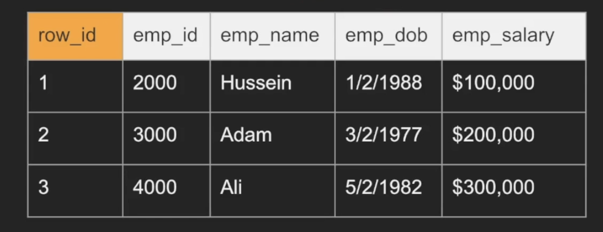
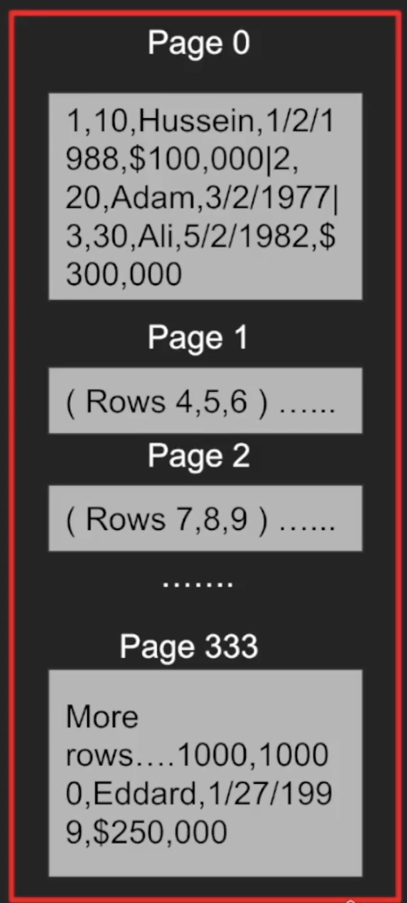
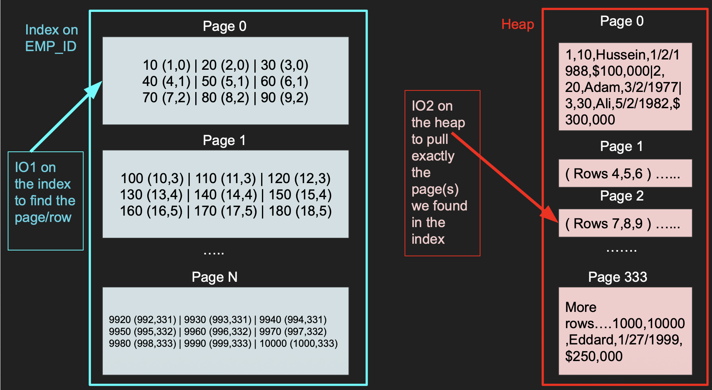
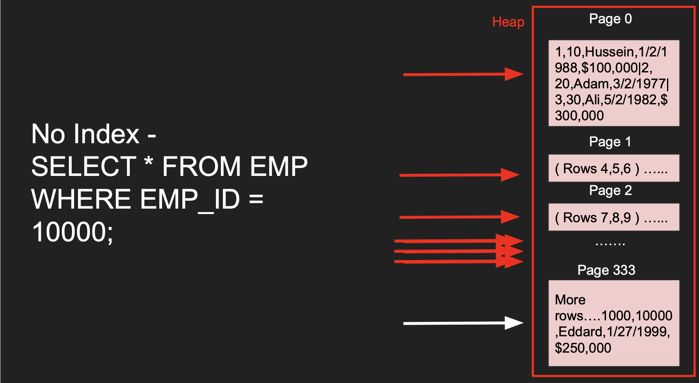
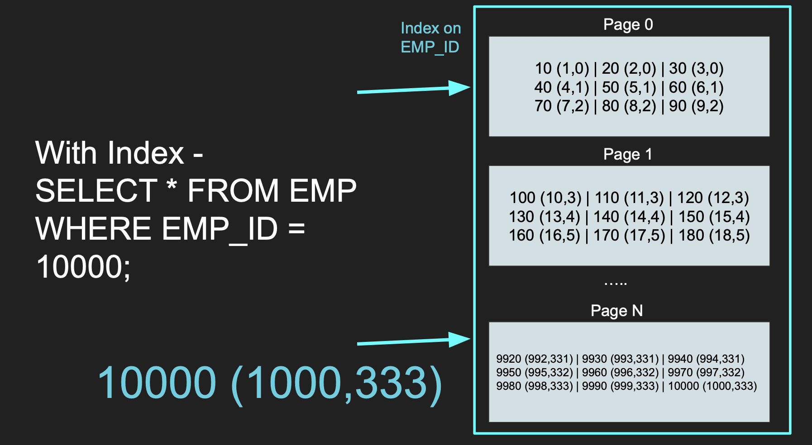
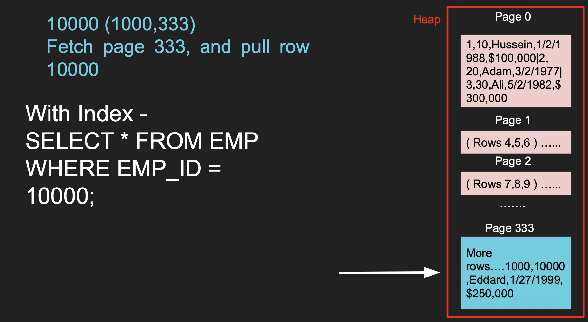

# DB INTERNALS

## Storage Concepts

### Table & Row ID

* Row ID is internal & system maintained.
* In certain databases like MySQL it is same as primary key `emp_id` but other databases like Postgres have a system maintained column (not visible logically) row_id (tuple_id) for querying purpose. 

### Page

* The table rows are stored & read in logical pages.
* The database doesn't read a single row, it reads a page or more in a single IO and we get a lot of rows in that IO.
* Each page has a size of (e.g. 8KB in Postgres & 16KB in MySQL)
* Assume each page holds 3 rows in example, with 1001 rows we will have ~333 pages.
* A single page cannot have different table rows (e.g. postgreSQL)

### IO

* IO operation (input/output) is a read request to a disk. A common misconception, it is not a sql query.
* We try to minimize this as much as possible.
* An IO can fetch 1 page or more depending on the disk partitions and other factors.
* An IO cannot read a single row, its a page with many rows in them.
* We want to minimize the number of IOs as they are expensive.
* Some IOs in operating systems goes to the operating system cache and not disk. (e.g. postgres heavily rely on os cache)

### Heap

* The Heap is data structure where the table is stored with all its pages one after another.
* This is where the actual data is stored including everything.
* A single heap can have multiple pages.
* Traversing the heap is expensive as we need to read so may data to find what we want.
* That is why we need indexes that help tell us exactly what part of the heap we need to read. 
* What page(s) of the heap we need to pull.
* Each row stores as tuple in heap pages especially in postgres.

### Index

* An index is another different data structure that has “pointers”.
* It has part of the data and used to quickly search for something.
* We can index (quick reference) on one column or more.
* Index pages do not live inside heap pages. They are stored in entirely separate files on disk, each formatted as 8 KB blocks specifically designed for that access method (e.g., B-Tree internal/leaf layout vs. Heap tuple layout).
* So, basically 2 or more separate IO's performed. 1 I/O to read the B-Tree root page. 1 I/O to jump to the heap page and fetch the actual tuple.
* Index tells you EXACTLY which page to fetch in the heap instead of taking the hit to scan every page in the heap.
* NOTE: The index is also stored as pages and cost IO to pull the entries of the index.
* The smaller the index, the more it can fit in memory the faster the search. So, avoid indexing every column in table.
* Popular data structure for index is b-trees.

The WHERE clause is still effective for filtering rows out of our result set, but it cannot skip reading pages without an index. PostgreSQL must perform a sequential scan across every heap page from disk to inspect each tuple against the condition.

If index is used, then we can skip reading pages sequential and search exactly the pages in heap with help of indexing using heap pointers. 

### Clustered Index vs. Heap-Organized Tables

* **Clustered Index (The Telephone Directory):** The book itself is physically ordered by the index key (e.g., alphabetically by name). Finding the entry means we are already holding the full row data on that exact page no extra lookup required. Because physical disk blocks can only be ordered one way, a table can only have **one** clustered index.
* **Heap + Secondary Index (The Textbook with an Index at the Back):** The rows are written in whatever order they were created (unordered heap). An index at the back simply maps a search key to a specific page number (`ctid` / physical pointer), requiring an extra hop to fetch the full row.
* A table's Primary Key is typically the clustered index by default in systems that support it (e.g., MySQL InnoDB, MS SQL Server).
* In non-clustered index, all user-defined indexes (including Primary Key indexes) are **secondary indexes**.
* Sometimes the heap table can be organized around a single index. This is called a clustered index or an Index Organized Table.
* Clustered Index = There is NO Heap pages. The B-Tree is the table. There is no separate "heap file" where rows live. (e.g. By default MySQL InnoDB uses clustered index, meaning only 1 type of page is available that is index pages & no heap pages)
* Non-Clustered (Secondary) Index = Index + Separate Heap. The table data lives in a completely separate, unordered collection of pages called the Heap. (e.g. Postgres, we have 2 different types of pages)

## Row vs Column Based Databases

